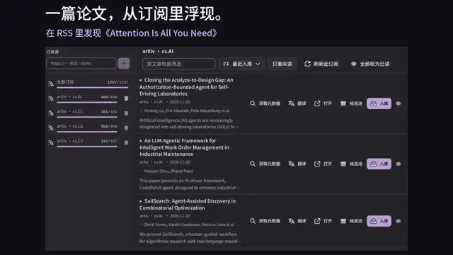

<div align="center">
  
  <h1>LitFolio</h1>
  <p><strong>追踪研究热点，专注论文阅读。</strong></p>
  <p>本地优先的桌面文献阅读工具 · 可选 AI 辅助 · Zotero 衔接</p>
  <p>
    <a href="https://github.com/lychen2/LitFolio/releases/latest"></a>
    <a href="https://github.com/lychen2/LitFolio/actions/workflows/ci.yml"></a>
    <a href="LICENSE"></a>
  </p>
  <p>
    <a href="https://github.com/lychen2/LitFolio/releases/latest">下载安装</a> ·
    <a href="#模型配置">模型配置</a> ·
    <a href="docs/manual/manual.pdf">中文手册</a> ·
    <a href="docs/manual/manual-en.pdf">English manual</a> ·
    <a href="CHANGELOG.md">更新记录</a>
  </p>
</div>

[](https://raw.githubusercontent.com/lychen2/LitFolio/main/media/litfolio-intro.mp4)

[播放高清短片 · 30 秒](https://raw.githubusercontent.com/lychen2/LitFolio/main/media/litfolio-intro.mp4)

---

LitFolio 把**发现论文 → 筛选收藏 → 阅读批注 → 推送 Zotero**串成一条日常工作流。论文、笔记、高亮与文献库保存在本机；阅读已有 PDF、批注和本地检索无需配置模型。

> A local-first desktop app for following research topics and reading papers. Keep your library on your machine, add AI when useful, and send selected papers to Zotero.

## 阅读工作流

| 环节 | 可以做什么 |
| --- | --- |
| **发现** | 浏览 arXiv 分类、订阅 RSS、跟踪主题提醒，在候补收件箱筛选论文。 |
| **整理** | 导入本地 PDF、arXiv 或 DOI；使用文件夹、标签与阅读状态管理文献，导出 BibTeX。 |
| **阅读** | 本地原文阅读、可选全文译文与 PDF 对照；PDF 高亮、笔记及选段翻译继续保存在文献库。 |
| **衔接** | 将选中的论文推送到本机 Zotero，继续管理引用与长期收藏。 |

界面提供多套配色、字体与字号设置。发现订阅、候补收件箱等能力由插件提供；可用插件取决于安装包的构建配置，在 **设置 → 插件** 中管理。包含相应插件的全新安装默认启用发现订阅与候补收件箱。

## 安装与开始使用

1. 在 [Releases](https://github.com/lychen2/LitFolio/releases/latest) 下载适合系统的安装包：Windows（安装程序 / MSI）、Linux（AppImage / DEB / RPM）。
2. 启动后，从 **导入** 添加 PDF、arXiv 链接或 DOI，进入文献库开始阅读。
3. 需要 AI 时，在 **设置 → LLM 配置** 添加模型、测试连接并保存。
4. 需要 Zotero 推送时，先启动本机 Zotero，再到 **设置 → 同步** 配置目标库。

默认文献库位于 `~/Litera-Library/`。更详细的操作说明见[中文手册](docs/manual/manual.pdf)和[英文手册](docs/manual/manual-en.pdf)。

## 模型配置

### 基础连接

LitFolio 使用 **OpenAI-compatible Chat Completions API**。填写服务端的 Base URL、API Key 和实际可用的模型 ID；也可以使用「获取模型」按钮选择模型。Base URL 填写接口根路径，例如 `https://api.openai.com/v1`，无需再附加 `/chat/completions`。

| 服务 | Base URL 示例 | 配置提示 |
| --- | --- | --- |
| Ollama | `http://localhost:11434/v1` | 先启动 Ollama 并下载聊天模型；本地服务通常不需要 API Key。 |
| OpenAI | `https://api.openai.com/v1` | 使用账号可访问的模型 ID。 |
| DeepSeek | `https://api.deepseek.com/v1` | 使用 DeepSeek 的 API Key 与模型 ID。 |
| SiliconFlow | `https://api.siliconflow.cn/v1` | 模型 ID 通常包含组织前缀，请以模型列表为准。 |
| Moonshot / Kimi | `https://api.moonshot.cn/v1` | 思考参数是否可用取决于具体模型。 |
| 自部署 / 中转 | 服务端提供的兼容接口地址 | 明确支持的参数格式后再开启思考控制。原生 Anthropic/Gemini 接口不能直接填入。 |

选择当前配置后点击 **保存**。核心阅读 AI 使用同一套当前模型配置。「测试连接」使用当前卡片中的参数，可在保存前检查兼容性。

- **输出 Token 上限**：限制单次生成长度。长摘要、翻译或推理任务可按模型容量提高；部分模型把思考消耗也计入该预算。
- **采样温度**：控制输出随机性。GPT-5 / o 系列与 Kimi K2.x 会自动省略此参数，避免与模型限制冲突。
- **Embedding 模型**：仅向量检索等功能需要，必须填写当前服务端实际支持的嵌入模型。普通阅读 AI 无需配置；预设名称不代表服务端一定提供该模型。

### 思考模式与参数传递

展开模型卡片中的 **「思考模式与接口兼容」**：

| 设置 | 行为 |
| --- | --- |
| **思考模式：自动** | 翻译和普通聊天模型优先请求关闭思考；识别到的推理模型在其他任务中保留服务端默认。明确选择推理强度时会请求开启思考。 |
| **思考模式：开启 / 关闭** | 覆盖任务默认。某些模型始终推理，无法关闭；已识别的不兼容设置会在请求前提示。 |
| **参数格式：识别接口** | 按已知服务地址选择对应字段；未知中转默认省略思考参数。未知接口若明确配置了模式或强度，会提示选择格式，避免默默漏传。 |
| **参数格式：手动选择** | 适合自部署或代理接口；按下表及服务端文档选择。 |
| **参数格式：不传递** | 不发送任何思考控制字段，采用服务端默认。 |
| **推理强度：低 / 中 / 高** | 使用 `reasoning_effort` 格式；布尔开关格式保持「自动」。强度与关闭思考不能同时生效。 |

**不同接口的字段并不通用：**

| 参数格式 | 实际请求字段 | 适用示例 |
| --- | --- | --- |
| `thinking.type` | `"thinking": {"type": "enabled" / "disabled"}` | 支持切换的 DeepSeek、Kimi K2.5 / K2.6 模型。 |
| `enable_thinking` | `"enable_thinking": true / false` | SiliconFlow 支持思考切换的模型。 |
| `chat_template_kwargs.enable_thinking` | `"chat_template_kwargs": {"enable_thinking": true / false}` | vLLM 等使用该模板参数的 Qwen3 部署；需手动选择。 |
| `reasoning_effort` | `"reasoning_effort": "none" / "low" / "medium" / "high"` | OpenAI 推理模型、Ollama 的兼容接口；可用值以具体模型为准。 |

Ollama 默认端口 `11434` 可自动识别；使用自定义端口或反向代理时，可手动选 `reasoning_effort`。此处调用的是 Ollama 的 `/v1/chat/completions`，并非原生 `/api/chat`，因此不发送原生 `think` 字段。上述扩展字段直接写入请求正文，不再套一层 `extra_body`。

GPT-5 初代、o 系列和 GPT-OSS 等模型不能完全关闭推理。保持自动或开启模式，并预留足够的输出预算。

**回答隔离**：普通 JSON 和流式 SSE 响应统一只提取正文，忽略独立的推理字段，清理正文中的 `<think>` / `<thinking>` 块。若只有思考而没有最终答案，会提示重试，不会把思考过程当作翻译或摘要保存。未标记、直接混在普通正文中的推理文字无法可靠区分。

参数依据：[DeepSeek](https://api-docs.deepseek.com/guides/thinking_mode/) · [Ollama](https://docs.ollama.com/api/openai-compatibility) · [SiliconFlow](https://docs.siliconflow.com/en/api-reference/chat-completions/chat-completions) · [Kimi](https://platform.kimi.ai/docs/api/models-overview) · [vLLM](https://docs.vllm.ai/en/stable/features/reasoning_outputs/) · [OpenAI](https://developers.openai.com/api/docs/guides/reasoning)

<details>
<summary><strong>连接或输出异常？</strong></summary>

- **提示不支持 `thinking` 等参数**：核对参数格式与模型能力；选择「不传递」可回到服务端默认，再测试连接。
- **没有最终答案 / 生成被截断**：调高输出 Token 上限，或在模型支持时关闭思考、降低推理强度。
- **拉取模型失败**：应用内模型下载仅用于 Ollama；云端模型请通过服务商管理。聊天模型也可使用 `ollama pull <模型ID>` 提前下载。
- **连接成功但向量检索失败**：确认当前服务端提供所填的 Embedding 模型；聊天和嵌入模型是两项独立能力。

</details>

## 数据与隐私

- **本地工作流**：文献库、导入文件、阅读笔记和高亮在本机保存。
- **显式联网**：在线发现、元数据查询、远程模型与可选文档解析会联系对应服务。调用远程 AI 时，相关论文内容或选段会发送至你配置的接口。
- **凭据存储**：优先使用系统钥匙串；系统安全存储不可用时，现有兼容逻辑可能保留本地配置中的凭据。备份或分享配置前请检查，勿提交 API Key。

## 从源码运行

需要 Node.js ≥ 20、pnpm、Rust，以及 [Tauri 2 系统依赖](https://tauri.app/start/prerequisites/)。

```bash
pnpm install
pnpm tauri:dev    # 启动桌面开发环境
pnpm tauri:build  # 构建 core profile 桌面安装包
```

`pnpm dev` 只启动前端开发服务器。`core` 构建会裁剪可选插件；需要全部插件时可使用：

```bash
node scripts/build-core-sidecar.mjs --force && \
  VITE_LITFOLIO_PROFILE=all LITFOLIO_PROFILE=all pnpm tauri build
```

以上环境变量写法适用于 Bash / zsh，Windows PowerShell 请使用 `$env:变量名="值"` 后执行命令。

### 阅读核心（打包二进制）

`pnpm tauri:dev` 与 `pnpm tauri:build` 会先运行 `scripts/build-core-sidecar.mjs`，通过 PyInstaller 将 `vendor/core/` 冻结为 `src-tauri/binaries/core-<triple>`，再由 Tauri `externalBin` 装进安装包。冻结产物自带 CPython，安装后的 LitFolio 无需系统 Python。

首次构建前准备 Python（上游要求 ≥ 3.10，发布流程使用 3.12）与打包依赖：

```bash
python -m pip install pyinstaller ./vendor/core
```

`pnpm tauri:dev` 按 `vendor/core/` 源码的修改时间决定是否重建，源码未变时直接复用已有产物。`pnpm tauri:build`、发布流程与手动指定 `--force` 时总是重新冻结。PyInstaller 不能交叉编译，`release.yml` 在每个目标平台上先构建侧车，再交给 tauri-action 打包。

<details>
<summary><strong>项目结构与验证命令</strong></summary>

```text
src/            React / TypeScript 界面与 IPC 契约
src-tauri/      Rust / Tauri 后端、SQLite 存储与 AI 调度
plugins/        可选插件 manifest
public/         品牌与静态资源
scripts/        构建与检查脚本
```

```bash
pnpm typecheck
pnpm lint
pnpm test
pnpm test:e2e
cd src-tauri && cargo test
```

</details>

## License

[GPL-3.0-or-later](LICENSE)。重合的阅读与文献库功能集成 [EasyRead](https://github.com/Edwardxlai/easyread)（MIT，上游源码见 `vendor/core/`），原作者版权与授权条款见 [THIRD_PARTY_NOTICES.md](THIRD_PARTY_NOTICES.md)。
